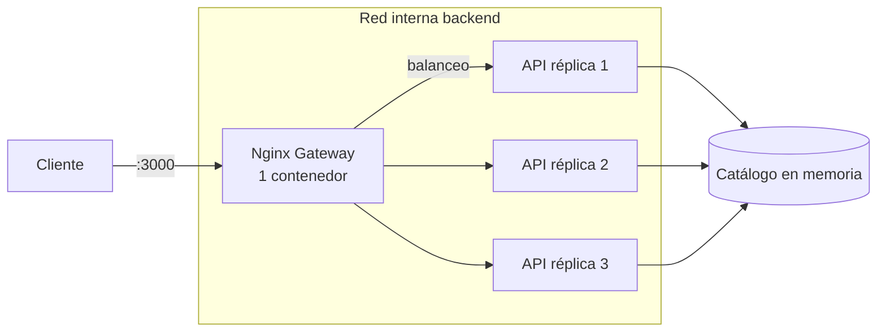
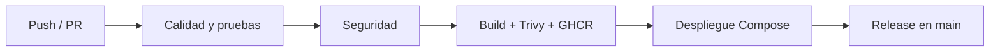

# 🎯 Perfumes API — EP2 DevOps

Microservicio de catálogo de perfumes (Node.js + Express) con pipeline CI/CD completo, contenedores, análisis de seguridad, despliegue simulado y orquestación con Docker Compose.


[](https://github.com/Moonlighpoio/perfumes-api/releases)
[](https://github.com/Moonlighpoio/perfumes-api/pkgs/container/perfumes-api)

---

## 📌 Descripción

API REST que permite listar, filtrar, buscar, ordenar y crear perfumes. El objetivo del EP2 es automatizar el ciclo de vida del microservicio: **código → pruebas → análisis de seguridad → imagen → despliegue → verificación**, con trazabilidad desde el commit hasta el entorno desplegado.

| Componente | Tecnología |
|---|---|
| Runtime | Node.js 24 |
| Framework | Express 5 |
| Pruebas | Jest + Supertest |
| Calidad | ESLint + umbral de cobertura |
| Contenedores | Docker multi-stage (non-root) |
| Orquestación | Docker Compose + 3 réplicas + Nginx |
| CI/CD | GitHub Actions |
| Seguridad | Dependabot + `pnpm audit` + Snyk + Trivy + CodeQL |
| Registro de imágenes | GitHub Container Registry (GHCR) |

---

## 🏗️ Arquitectura



- Solo el **gateway Nginx** publica el puerto `3000`.
- La **API** corre con 3 réplicas, sin puertos publicados, en una red interna.
- Cada contenedor tiene healthcheck, límites de CPU/memoria, filesystem de solo lectura, `cap_drop: ALL` y `no-new-privileges`.

---

## 🔌 Endpoints

| Método | Endpoint | Descripción |
|---|---|---|
| GET | `/health` | Estado del servicio y versión |
| GET | `/perfumes` | Lista, filtra, busca y ordena perfumes |
| GET | `/perfumes/:id` | Obtiene un perfume por ID |
| POST | `/perfumes` | Crea un perfume |

### Query params de `GET /perfumes`

| Param | Descripción | Ejemplo |
|---|---|---|
| `category` | Filtra por categoría | `?category=femenino` |
| `search` | Busca por nombre (sin distinguir mayúsculas) | `?search=chanel` |
| `sort` | Ordena por precio (`price_asc` / `price_desc`) | `?sort=price_asc` |

### Ejemplos

```bash
curl http://localhost:3000/health
curl http://localhost:3000/perfumes
curl "http://localhost:3000/perfumes?category=femenino&search=chanel&sort=price_asc"
curl http://localhost:3000/perfumes/1

curl -X POST http://localhost:3000/perfumes \
  -H "Content-Type: application/json" \
  -d '{"name":"Bleu de Chanel","brand":"Chanel","price":119990,"category":"masculino","stock":5}'
```

---

## 🚀 Ejecución local

### Con Node.js

```bash
pnpm install
pnpm dev        # desarrollo con nodemon
pnpm start      # producción
pnpm test       # pruebas
pnpm test:ci    # pruebas + cobertura + umbral
pnpm lint       # análisis estático
```

### Con Docker

```bash
docker build -t perfumes-api:local .
docker run --rm -p 3000:3000 perfumes-api:local
```

### Con Docker Compose (orquestado)

```bash
docker compose up -d --build --wait
docker compose ps
pnpm smoke
docker compose down -v
```

El gateway queda disponible en `http://localhost:3000`.

---

## 🔄 Pipeline CI/CD

Workflow: [`.github/workflows/ep2.yml`](.github/workflows/ep2.yml)

Se ejecuta en **push a `develop`/`main`**, **pull requests** y manualmente (`workflow_dispatch`). Los jobs se encadenan con `needs`, por lo que un fallo detiene las etapas siguientes.

| # | Job | Qué hace | Gate |
|---|---|---|---|
| 1 | **Calidad y pruebas** | `pnpm lint`, Jest + Supertest, cobertura | Falla si lint o tests fallan, o si la cobertura baja de 90% |
| 2 | **Seguridad** | `pnpm audit --prod`, Snyk Open Source, Snyk Code (SAST), CodeQL | Falla con vulnerabilidades altas/críticas |
| 3 | **Imagen Docker** | Build multi-stage, escaneo Trivy, artefacto, push a GHCR | Falla si Trivy detecta HIGH/CRITICAL corregibles |
| 4 | **Despliegue** | Compose con 3 réplicas + Nginx, healthchecks y smoke tests | Falla si el entorno no responde o no hay 3 réplicas |
| 5 | **Release** (solo `main`) | Crea tag y release `vX.Y.Z` | Trazabilidad versión → commit |

### Flujo



### Política de calidad (IE2)

- **30 pruebas automatizadas** con Jest + Supertest sobre la app real.
- Cobertura mínima bloqueante: **90%** en statements, branches, functions y lines (`jest.config.js`).
- ESLint con `no-undef` como error.
- Smoke tests de integración contra el entorno desplegado (`scripts/smoke-test.mjs`).

### Política de seguridad (IE3)

- **Dependabot** semanal para npm, Docker y GitHub Actions (`.github/dependabot.yml`).
- **`pnpm audit --prod`** bloqueante en cada ejecución.
- **Snyk Open Source** para dependencias (`snyk test`), bloqueante con severidad `high`.
- **Snyk Code** para análisis estático (`snyk code test`), bloqueante con severidad `high` (0 hallazgos en el último análisis).
- **CodeQL** analiza el código JavaScript/TypeScript en cada push, PR y semanalmente, y publica los hallazgos en la pestaña *Security*.
- **Trivy** escanea la imagen construida y publica resultados SARIF en la pestaña *Security*.
- **Bloqueo real**: `docker` depende de `security`; `deploy` depende de `docker`. Si la seguridad falla, no se construye ni despliega.
- Hardening de contenedores: usuario no-root, `read_only`, `cap_drop: ALL`, `no-new-privileges`, límites de recursos y healthchecks.

> `SNYK_TOKEN` está configurado. Snyk Open Source y Snyk Code se ejecutan en cada pipeline; si no existiera el secreto, el pipeline seguiría funcionando con `pnpm audit` + Trivy y mostraría una advertencia.

### Escalabilidad y orquestación (IE3 / IE5)

- **3 réplicas** de la API (`deploy.replicas: 3`) detrás de Nginx.
- Balanceo con `upstream` de Nginx y afinidad por IP (`ip_hash`) sobre las 3 réplicas.
- DNS interno de Docker con `resolver 127.0.0.11` para refrescar las IPs de las réplicas.
- La afinidad por IP mantiene consistencia entre `POST` y `GET` sobre el catálogo en memoria.
- Límites y reservas de CPU/memoria por servicio.
- Healthchecks de API y gateway; `depends_on` con `condition: service_healthy`.
- Red interna segmentada: la API no está expuesta directamente.

### Despliegue y trazabilidad (IE4)

| Etapa | Evidencia |
|---|---|
| Código | Commit `GITHUB_SHA` |
| Imagen | `ghcr.io/moonlighpoio/perfumes-api:<SHA>` (tag inmutable, publicado en GHCR) |
| Artefacto | `image.tar` publicado en el run (fuente del despliegue) |
| Entorno | `staging` (develop) / `production` (main) con historial de deployments |
| Verificación | Healthcheck + smoke tests contra el gateway |
| Versión | Release/tag `vX.Y.Z` en `main` |

Cada deployment queda asociado al commit y al entorno en GitHub Actions. La imagen se etiqueta con el SHA, por lo que se puede reconstruir o volver a desplegar exactamente la misma versión (rollback: desplegar un SHA anterior).

---

## ⚙️ Configuración del repositorio

Estos pasos se ejecutan **una vez** y requieren permisos de administrador:

```bash
gh auth login
REPO=Moonlighpoio/perfumes-api bash scripts/configure-repo.sh
```

El script:

- Configura descripción y topics del repositorio.
- Activa alertas de vulnerabilidades y actualizaciones de seguridad de Dependabot.
- Protege `develop` y `main` exigiendo PR y los checks `Calidad y pruebas`, `Seguridad` e `Imagen Docker`.
- Crea el secreto `SNYK_TOKEN` si se entrega por variable de entorno.

Para configurar Snyk manualmente:

```bash
gh secret set SNYK_TOKEN --repo Moonlighpoio/perfumes-api
```

---

## 🌿 Estrategia de ramificación (GitFlow)

| Rama | Propósito |
|---|---|
| `main` | Producción estable; dispara deploy a `production` y release |
| `develop` | Integración continua; deploy a `staging` |
| `feature/*` | Nuevas funcionalidades |
| `hotfix/*` | Correcciones urgentes desde `main` |

Los merges a `develop` y `main` se realizan por Pull Request con checks obligatorios.

### Convención de commits

`feat:`, `fix:`, `test:`, `ci:`, `docs:`, `chore:`, `refactor:`.

---

## ✅ Evidencias de ejecución

| Fecha | Rama / entorno | Evidencia | Resultado |
|---|---|---|---|
| 2026-10-30 | `develop` / staging | [Run 41016523460](https://github.com/Moonlighpoio/perfumes-api/actions/runs/41016523460) | ✅ Calidad, seguridad (Snyk Open Source + Snyk Code 0 issues), imagen y despliegue |
| 2026-10-30 | `main` / production | [Run 41016526100](https://github.com/Moonlighpoio/perfumes-api/actions/runs/41016526100) | ✅ Pipeline completo + release |
| 2026-10-30 | CodeQL | [develop](https://github.com/Moonlighpoio/perfumes-api/actions/runs/41014265241) / [main](https://github.com/Moonlighpoio/perfumes-api/actions/runs/41014267878) | ✅ 0 alertas abiertas |
| 2026-10-30 | Release | [v2.0.0](https://github.com/Moonlighpoio/perfumes-api/releases/tag/v2.0.0) | ✅ Tag y release creados |
| 2026-10-30 | Imagen | [GHCR](https://github.com/Moonlighpoio/perfumes-api/pkgs/container/perfumes-api) | ✅ Tags `develop`, `main`, `latest` y SHA |

### Verificación local (previa al push)

```
pnpm lint                 -> OK
pnpm test:ci              -> 30/30 pruebas, 100% cobertura
pnpm audit --prod         -> 0 vulnerabilidades
docker build              -> OK (multi-stage, non-root)
trivy image (HIGH/CRIT)   -> 0 vulnerabilidades corregibles
docker compose up --wait  -> 3 réplicas de API + gateway healthy
smoke test                -> 11 verificaciones OK
```

---

## 🗺️ Cumplimiento de la rúbrica

| Indicador | Peso | Evidencia |
|---|---|---|
| **IE1** Contenedores | 20% | `Dockerfile` multi-stage, `.dockerignore`, build en job `docker`, imagen non-root |
| **IE2** Pruebas automatizadas | 20% | `tests/perfumes.test.js`, `jest.config.js`, umbral 90%, job `quality` |
| **IE3** Seguridad y escalabilidad | 20% | `.github/dependabot.yml`, Snyk, CodeQL, Trivy, `pnpm audit`, gates con `needs`, réplicas y límites |
| **IE4** Despliegue y trazabilidad | 20% | Job `deploy`, entornos staging/production, tag SHA, GHCR, smoke tests, release |
| **IE5** Orquestación | 20% | `compose.yaml` con 3 réplicas, Nginx, red interna, healthchecks, hardening |

---

## 👥 Equipo

| Integrante | GitHub | Rol |
|---|---|---|
| Matias Gonzalez V. | [@wsk4](https://github.com/wsk4) | CI/CD, Docker y seguridad |
| Renato Barriga P. | [@Moonlighpoio](https://github.com/Moonlighpoio) | API, pruebas y orquestación |
| Cristobal Veliz L. | [@Veliz1232](https://github.com/Veliz1232) | Pipeline, despliegue y documentación |

---

## 🤖 Uso de Inteligencia Artificial

Se utilizó IA (OpenCode) como apoyo para: estructura del pipeline, Dockerfile, configuración de Compose, pruebas automatizadas y redacción técnica del README. Todo el contenido fue revisado y validado por el equipo.

Las **reflexiones individuales** deben ser redactadas por cada integrante sin apoyo de IA, según la pauta del curso. Referencia: <https://bibliotecas.duoc.cl/ia>.

---

## 📝 Conclusiones y reflexiones individuales

> ⚠️ Cada integrante debe completar su reflexión personal (sin IA): qué aprendió, qué aportó y qué dificultad enfrentó.

### Integrante 1 — Nombre
_Pendiente de completar por el integrante._

### Integrante 2 — Nombre
_Pendiente de completar por el integrante._

### Integrante 3 — Nombre
_Pendiente de completar por el integrante._

---

## 📄 Licencia

MIT — proyecto académico de Ingeniería DevOps (DOY0101).
